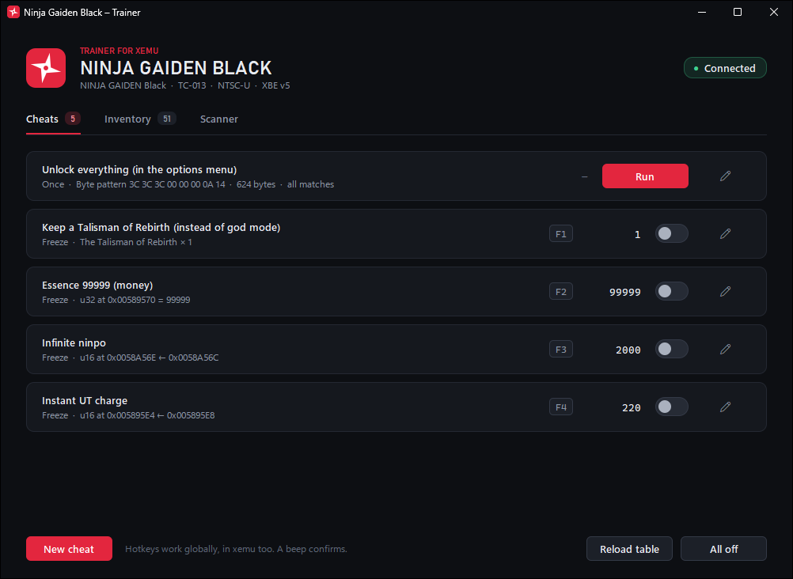
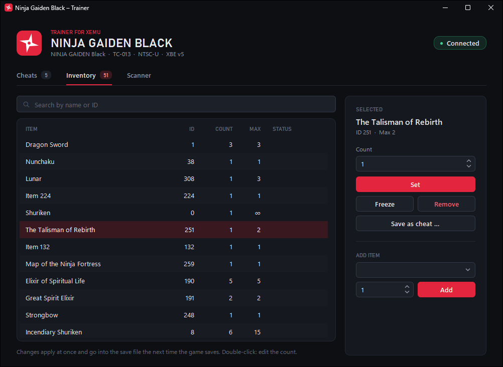
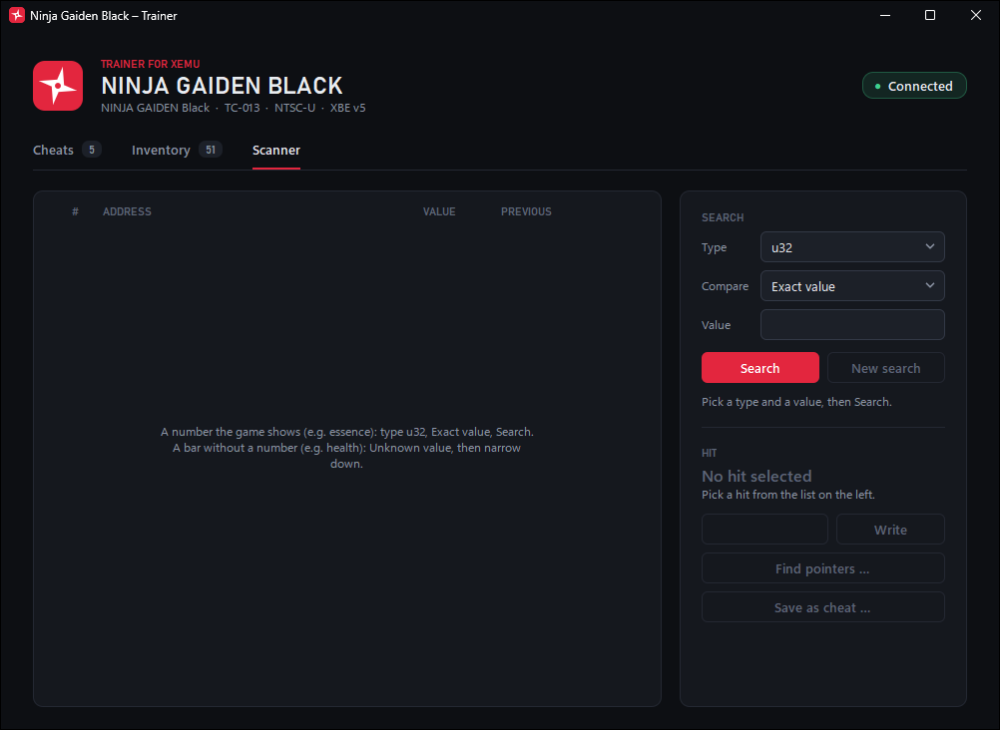

# Ninja Gaiden Black Trainer for xemu

[](#requirements)
[](https://www.python.org/)
[](LICENSE)

A trainer for **Ninja Gaiden Black** (Xbox, NTSC-U, title ID `TC-013` / `0x5443000D`) running in the
[xemu](https://xemu.app) emulator on Windows. Written in plain Python: no Cheat Engine, no DLL
injection, no patched game files.



## Features

- **Ready-made cheats:** money (essence), infinite ninpo, instant Ultimate Technique charge,
  auto-revive and unlocking everything. Each one has a hotkey.
- **Hotkeys everywhere:** switch cheats with a keyboard hotkey or a controller combo, even while
  xemu runs in fullscreen. A beep confirms each switch.
- **Inventory editor:** set item counts, add, remove and freeze items. Item names and limits come
  straight from the game.
- **No soft resets:** NGB checks its own state with checksums and resets to the title screen when
  something changes behind its back. The trainer tells the game that its changes are intended.
- **Memory scanner** like Cheat Engine (exact/unknown value, increased/decreased …, byte patterns)
  and a **pointer scanner**. You can save any hit as a cheat, in the GUI or in a console.
- **Cheat editor:** create and edit cheats in the window and record hotkeys by pressing them.
  Everything is stored in a plain `cheats.json`.
- Works with **Xbox addresses**, so a cheat keeps working after xemu restarts.

| Inventory | Scanner |
|---|---|
|  |  |

## Requirements

- Windows 10 or 11
- 64-bit Python 3.10 or newer
- [xemu](https://xemu.app) with **Ninja Gaiden Black, NTSC-U, XBE version 5** (`trainer.bat info`
  shows the version). The built-in cheats and the inventory need exactly this build. The scanner
  and your own address cheats work with any game.

## Installation

Download this repository (**Code → Download ZIP** above, then unpack it) or clone it with git.
Then, in the project folder:

```
python -m venv .venv
.venv\Scripts\pip install -r requirements.txt
```

The only dependency is `numpy`, which the scanner uses.

## Usage

Start xemu with Ninja Gaiden Black, then:

| Command            | What it does                                                          |
|--------------------|-----------------------------------------------------------------------|
| `trainer.bat`      | Trainer window (double-click works too)                               |
| `trainer.bat info` | Check the connection, show the game and the current cheat values      |
| `trainer.bat scan` | Scanner in the console (same as the tab, plus a hex dump with `peek`) |
| `trainer.bat demo` | Trainer window against a simulated xemu (from `tests/`), no game needed |

The window may be started before xemu. It connects on its own, and reconnects after xemu
restarts. Cheats are only applied while the game from `title_id` is running.

The window runs without a console (`pythonw`). Startup errors, for example in `cheats.json`, show
up as a message box. Unexpected errors (bugs) also go to `trainer.log`. Window size, position and
the last open tab are kept per user in `%LOCALAPPDATA%\ngbtrainer\settings.json`.

> **Tip:** Back up your save before you experiment. Quit xemu and copy `hdd\xbox_hdd.qcow2`.

## Built-in cheats

| Cheat                                            | Key | What it does |
|--------------------------------------------------|-----|--------------|
| Unlock everything (in the options menu)          | –   | Unlocks everything; run it once in the options menu |
| Keep a Talisman of Rebirth (instead of god mode) | F1  | There is always a Talisman of Rebirth in the inventory |
| Essence 99999 (money)                            | F2  | Keeps essence at the game's maximum of 99999 |
| Infinite ninpo                                   | F3  | Keeps the ninpo gauge full |
| Instant UT charge                                | F4  | The Ultimate Technique is fully charged right away |

All of them can be changed in the window (pencil icon), for example to give them other hotkeys or
controller combos.

### Unlock everything

This cheat applies the byte-pattern recipe from the video
[Unlock Everything in NINJA GAIDEN Black (xemu)](https://www.youtube.com/watch?v=N-N_-KnnNo0):

1. Back up your save.
2. In the game, open the **options menu**.
3. Click **Run** on *Unlock everything*. The value column shows `OK (2x)`.
4. Leave the options menu so the game saves, then check the unlocks.

The trainer looks for the pattern `3C 3C 3C 00 00 00 0A 14` and writes 624 bytes from there. NGB v5
(NTSC-U) keeps two identical copies of this data in the options menu, and both are written
(`"all_matches": true`) so they stay the same. If the pattern is not found, you are in the wrong
menu. The block also overwrites a few settings, so check your options afterwards.

### Talisman of Rebirth (auto-revive)

Keeps one Talisman of Rebirth in the inventory. When Ryu dies, the talisman revives him and the
trainer puts a new one in right away. This replaces a god mode.

### Essence (money)

Keeps essence at 99999, the game's maximum, so shopping costs nothing. Higher values are not
possible: the game shows them as 99999 and cuts them down to 99999 the next time Ryu collects
essence. To top up only once, set the cheat's mode to *Once* in the editor.

### Infinite ninpo

Copies the size of the ninpo gauge (`0x0058A56C`) into the current ninpo (`0x0058A56E`), both u16,
so ninpo arts cost nothing.

### Instant UT charge

With this cheat the Ultimate Technique is fully charged about half a second after you press Y,
instead of after a little over 4 seconds. The half second is the wind-up before charging starts.
The game needs it to tell a tap from a hold.

How the game charges: while Ryu charges, the counter `0x005895E4` (u16) goes up by one per frame
(60 per second). When it reaches step 1 (`0x005895E6`, normally 100) or step 2 (`0x005895E8`,
normally 220), the charge level goes up. An armlet with a UT effect divides both steps. The game
sets the steps again every frame, so freezing them does nothing. Instead, the cheat copies step 2
into the counter, which is what the game does itself when Ryu absorbs essence while charging.

## Inventory editor

Load a save, then open the **Inventory** tab. The list shows every item with its ID, current count
and the maximum the game allows (`∞` = the count never goes down).

- **Search:** the search field filters by name or ID; `Esc` clears it.
- **Set:** select a row (double-click jumps to the count field), enter a count, then click *Set* or
  press `Enter`. For weapons the count is the weapon level (Dragon Sword 1–3).
- **Add:** pick an item under *Add item* (or type an ID), enter a count, click *Add*. If the item is
  already there, only its count is set.
- **Remove:** select a row, click *Remove*.
- **Freeze / Unfreeze:** holds the entered count until the trainer closes.
- **Save as cheat:** turns it into a permanent cheat with the entered count, with a hotkey if you
  like (opens the cheat editor).

Changes apply at once and go into the save file the next time the game saves. The game cuts
counts above the maximum down to the maximum the next time Ryu picks up that item.

## Creating and editing cheats

**New cheat** (bottom of the Cheats tab) or the pencil on a card opens the editor:

- **Target:** an *address* (optionally with a pointer chain), an *item* from the inventory, or a
  *byte pattern* the trainer searches for when the cheat runs.
- **Value:** a *fixed value*, the value *when switched on* (which is then held), or *copy from*
  another address, for example health = max health.
- **Mode:** *Freeze* writes continuously, *Once* writes once per click or hotkey press.
- **Hotkeys:** click *Record*, press the keys or controller buttons together and release them; `Esc`
  cancels. You can also type them, e.g. `CTRL+F1` or `BACK+DPAD_UP`.

All hotkeys pause while the editor is open. *Save* writes `cheats.json` and reloads the table; cheats
that were on stay on. *Delete* asks once.

## Finding addresses

Known addresses (NGB NTSC-U v5): karma `0x00589560` (u32), essence `0x00589570` (u32), ninpo
`0x0058A56E` and max ninpo `0x0058A56C` (u16), UT charge `0x005895E4` (u16), inventory `0x005891D0`.
Anything else you find once with the scanner, and then it works for good.

### In the Scanner tab

1. **A number on screen** (e.g. essence 1250): type `u32`, compare *Exact value*, value `1250`,
   *Search*. Collect essence in the game, enter the new amount, *Narrow down*. Repeat until only a few
   hits are left. If you find nothing, try `u16` or `i32`.
2. **A bar without a number** (e.g. health): type `u16` (or `f32`, `u32`), *Unknown value*, *Search*.
   Take damage → *Decreased*, do nothing → *Unchanged*, heal → *Increased*, each followed by
   *Narrow down*.
3. Select a hit; the current value is shown on the right. Use *Write* to test whether something
   changes in the game, then **Save as cheat …** – the editor opens already filled in.
4. **Find pointers …** finds pointers to the hit (see below). *Go back further* looks for pointers
   to a pointer for longer chains; *Save as cheat* takes over the whole chain.

The list shows the first 200 hits with live values. *New search* starts over. The type
*Byte pattern* searches for bytes like `3C 3C ?? 00` (`??` = any byte).

**Why pointers:** values of enemies or of Ryu often live in objects the game creates at runtime.
Their address can change after a chapter change, loading or a restart. A **pointer chain** from a
fixed address still finds them. *static* means the pointer lives in the loaded XBE image; those are
the best candidates. Check a chain after a level change and a restart.

### In the console (`trainer.bat scan`)

#### Example 1: essence (a number on screen)

```
scan> scan u32 1250          # current essence, exact value
4,812 hits
      ... collect or spend essence in the game ...
scan> next 1730              # new amount
2 hits
   1  VA 0xD0012340  PA 0x0012340  = 1730
   2  VA 0x80045670  PA 0x0045670  = 1730
scan> set 1 99999            # test: does the display change in the game?
scan> add 1 "Essence 99999" value=99999 once key=F2
```

If `u32` finds nothing, try `u16` or `i32`.

#### Example 2: a health bar (no number shown)

```
scan> scan u16 ?             # unknown value (alternatives: f32, u32)
      ... take damage ...
scan> next <                 # decreased
      ... do nothing ...
scan> next =                 # unchanged
      ... heal ...
scan> next >                 # increased
      ... repeat until only a few hits are left ...
scan> list
scan> add 1 "Infinite health" key=F1 pad=BACK+DPAD_UP
```

Without `value=`, the cheat freezes the value it finds when switched on, so switch it on at full
health.

#### Pointers

```
scan> ptr 1                  # what points to hit 1? (max. offset 0x1000)
0x00ABCDE0 [static]  -> 0xD0001000 + 0x84    "address": "0x00ABCDE0", "offsets": ["0x84"]
scan> add 0x00ABCDE0 "Infinite health" type=u16 offsets=0x84 key=F1
```

For longer chains, run `ptr` again on the pointer you found. Check a chain after a level change
and a restart with `trainer.bat info`.

#### All scanner commands

`help` in the scanner lists all commands: `scan`, `next`, `list`, `set`, `peek` (hex dump),
`aob` (search a byte pattern), `ptr`, `add`, `info`, `quit`. Give an address either as a hit number
from `list` or as `0x…`.

*The addresses in these examples are placeholders. Find your real ones with the scanner.*

## The `cheats.json` format

The editor in the window writes this file; editing it by hand works too.

```json
{
  "title_id": "0x5443000D",
  "interval_ms": 50,
  "cheats": [
    { "name": "Infinite health", "type": "u16", "address": "0x00ABCDE0", "offsets": ["0x84"],
      "copy_from": { "address": "0x00ABCDE0", "offsets": ["0x86"] },
      "hotkey": "F5", "pad": "BACK+DPAD_UP" },
    { "name": "Essence 99999", "type": "u32", "address": "0x00589570",
      "value": 99999, "mode": "once", "hotkey": "CTRL+F2" },
    { "name": "Keep a Talisman of Rebirth", "item": 251, "value": 1, "hotkey": "F1" }
  ]
}
```

| Field         | Meaning |
|---------------|---------|
| `type`        | `u8` `i8` `u16` `i16` `u32` `i32` `f32`, or `bytes` (a block of bytes, `value` as hex text) |
| `address`     | Virtual Xbox address (as a string, so hex works) |
| `offsets`     | Optional pointer chain, `[[address]+o1]+o2 …` like in Cheat Engine |
| `value`       | Target value. Without it (and without `copy_from`) the value found when switching on is frozen |
| `copy_from`   | Take the value from another address, e.g. health = max health |
| `mode`        | `freeze` (default, writes continuously) or `once` (writes once, by button or hotkey) |
| `hotkey`      | Keyboard: `F1`–`F24`, `NUM0`–`NUM9`, `A`–`Z`, `0`–`9`, `INSERT`, `HOME` …, combined with `CTRL+` `ALT+` `SHIFT+` |
| `pad`         | Controller: `A B X Y LB RB LT RT BACK START LS RS DPAD_UP DPAD_DOWN DPAD_LEFT DPAD_RIGHT` (combined with `+`) |
| `aob`         | Instead of `address`: find the target by a byte pattern (`??` = any byte), only with `mode: once` |
| `item`        | Instead of `address`: an item ID from the Inventory tab; `value` is the count (0–255). A missing item is added |
| `all_matches` | With `aob`: write to every match. Otherwise nothing is written when there are several |
| `title_id`    | Cheats only apply while this game runs (`null` = always) |
| `interval_ms` | How often frozen values are written |

After editing the file by hand, click **Reload table** in the window. Hotkeys work globally, even
when xemu is in the foreground. While you type into a text field in the trainer window, keyboard
hotkeys pause (controller combos don't).

If one combo switches several cheats, the card shows a yellow warning. That happens with the same
key twice (`F1` two times) or when one combo contains another (`CTRL+F1` also switches the cheat on
`F1`, `BACK+DPAD_UP` also the one on `BACK`). If you want that, it is allowed, and both cheats then
switch together.

## Notes

- **Soft reset:** NGB keeps checking the inventory, karma, essence, ninpo and a few other values with
  checksums. If one of them changes behind its back, it jumps back to the title screen. The trainer
  reports its changes to the game as intended (see *How it works*). This also covers your own cheats
  and `set` in the scanner, as long as the addresses are in one of the protected ranges in
  `ngbtrainer/ngb.py`. This works only with NGB NTSC-U, XBE version 5.
- The trainer changes **data** only. Code patches such as NOPs would be unreliable, because xemu
  translates the game code ahead of time (JIT) and doesn't notice direct changes to it.
- The trainer must run with the same rights as xemu. If xemu runs as administrator, the trainer
  has to as well.

## How it works

xemu keeps the Xbox RAM (64 or 128 MiB) as one block of memory in its own process. The trainer
finds this block with `VirtualQueryEx`. It recognizes it by the Xbox kernel's page directory at
physical address `0xF000`, which maps itself through entry `0x300`. The trainer translates virtual
addresses through these page tables exactly like the Xbox CPU, with 4 KiB and 4 MiB pages. It
identifies the game by the XBE header at `0x00010000`.

**Inventory and anti-tamper (NGB NTSC-U v5):** the inventory is at `0x005891D0` and has 128 slots of
4 bytes: item ID (u16), count (u8), 1 unused byte. Free slots have count 0 and ID `0xFFFF`. The game
also sums up 24 groups of its data (inventory, karma, essence, ninpo …), stores the sums encrypted at
`0x007F1AB0` and compares them all the time (the check is at `0x00164E50`). If one differs, the game
soft-resets. For its own changes the game sets a flag per group at `0x007F1A94 + group`; the next
check then seals the group again instead of comparing it. The trainer sets the same flag before and
after every write into a protected group. It reads item names and limits from the game's own tables.

```
ngbtrainer/
  winproc.py   Win32: processes, ReadProcessMemory/WriteProcessMemory, VirtualQueryEx
  xbox.py      Finding the RAM, page tables, XBE header
  ngb.py       NGB specifics: inventory, item tables, checksum flags, known addresses
  cheats.py    Loading/writing cheats.json, applying cheats
  trainer.py   Connection and freeze loop (no UI)
  hotkeys.py   Keyboard (GetAsyncKeyState) and controller (XInput)
  scanner.py   Value search, pointer search, scanner console, search for the Scanner tab
  worker.py    Trainer and hotkeys in a background thread; the window sends commands and shows snapshots
  gui.py       Tkinter window (Cheats, Inventory)
  editor.py    Cheat editor (dialog)
  scan_tab.py  Scanner tab and pointer search
  widgets.py   Custom widgets: switch, tabs, status, toasts, search field, dialogs, hotkey recording
  theme.py     Colors, fonts, DPI, ttk styles; rounded shapes drawn as PNGs at runtime
  settings.py  Window size, position, last tab
tests/         Tests against a simulated xemu process (also used by trainer.bat demo)
```

## Running the tests

```
.venv\Scripts\python -m unittest discover -s tests -v
```

The tests run against a simulated xemu process (`tests/fake_xbox.py`), so neither xemu nor the game
is needed.

## Contributing

Bug reports, new addresses and pull requests are welcome. Please run the tests before you open a
pull request. If you found a new address, mention how you verified it in the game.

## Disclaimer

This is a fan project for single-player use. It is not affiliated with or endorsed by Koei Tecmo,
Team Ninja, Microsoft or the xemu project. Ninja Gaiden is a trademark of its respective owner. The
repository contains no game files; the trainer reads item names and other game data from your own
running copy of the game. Use it at your own risk and back up your saves.

## Credits

- The *Unlock everything* recipe comes from the video
  [Unlock Everything in NINJA GAIDEN Black (xemu)](https://www.youtube.com/watch?v=N-N_-KnnNo0).
- [xemu](https://xemu.app), the Xbox emulator this trainer is built for.

## License

[MIT](LICENSE)
